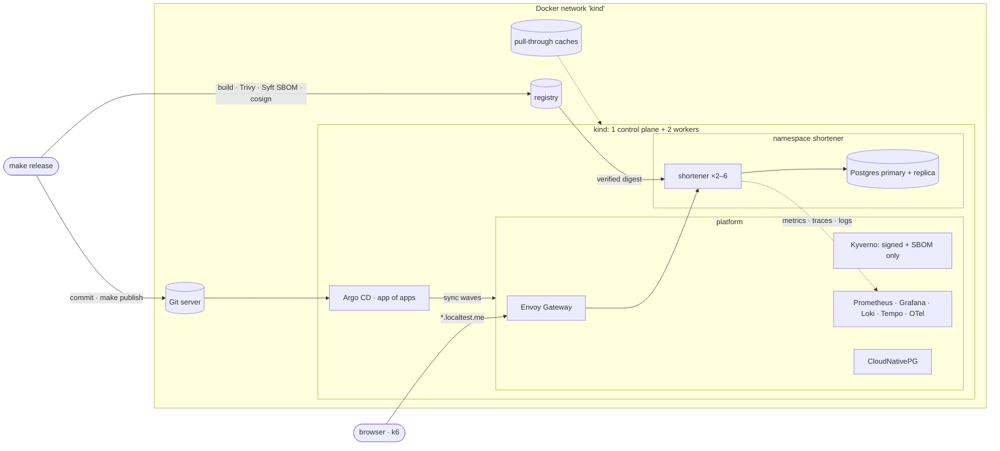

# Slipway

[](https://github.com/Mohamed-H-Essa/k8s_platform_bootstrap/actions/workflows/ci.yml)

**A production-style GitOps platform that runs entirely on a laptop.** One command builds a
three-node Kubernetes cluster with Terraform, and Argo CD installs the rest from Git: a Gateway API
entry point, signed-image admission, metrics/logs/traces with SLO burn-rate alerts, and a
highly available Postgres. A small Go service runs on it, and a chaos day breaks it on purpose
under load and measures the recovery.

No cloud account needed. The AWS version of the same design is written in Terraform and checked
offline (`validate`, `tflint`, `trivy config`), but has never been applied: there is no AWS account
behind this project.

## Architecture



More: [docs/architecture.md](docs/architecture.md) and the decision records in [docs/adr/](docs/adr/).

## Quick start

Requirements: Docker with **8 GB** of memory (OrbStack, Docker Desktop or Colima), about 15 GB of
disk, and `make`, `terraform` (≥ 1.5), `kubectl`, `helm`, `yq`, `jq`, `trivy`, `syft`, `cosign`,
`k6`, `git`. Go is only needed for `make test`. Port 80 on `127.0.0.1` must be free.

```bash
make up        # cluster, registry, caches, Git, Argo CD, then the whole platform from Git
make smoke     # create a short link through the gateway, follow it, check the UIs
make unsigned  # try to run an unsigned image: Kyverno refuses it
make load      # 2 minutes of k6 traffic against the SLOs
make release   # build, scan, sign and ship a new version through Git
make chaos     # chaos day: pod kill, node loss, database failover, bad release
make down      # delete the cluster (image caches stay warm)
```

| What | Where |
|---|---|
| Shortener | http://sho.localtest.me (`POST /api/links {"url": "https://…"}`) |
| Grafana | http://grafana.localtest.me (dashboard **Shortener · service and SLOs**; anonymous viewer) |
| Argo CD | http://argocd.localtest.me (`admin`, password from `make urls`) |
| Prometheus | http://prometheus.localtest.me |

`*.localtest.me` is public DNS that resolves to `127.0.0.1`; kind maps port 80 to the gateway.

## Measured on a laptop

<!-- numbers: filled in from real runs only -->
NUMBERS

## How it works

**GitOps.** Terraform creates the cluster and installs exactly two things: Argo CD and one root
Application. The root renders [`platform/apps`](platform/apps), a Helm chart with one Application
per component in sync waves (operators and CRDs → what builds on them → the workload). Locally Argo
CD pulls from a Git server next to the cluster ([why](docs/adr/git-server-next-to-the-cluster.md));
`make publish` pushes your commits there. Manual changes in the cluster are reverted by self-heal.

**Release.** `make release` builds the image, fails on fixable HIGH/CRITICAL vulnerabilities
(Trivy), pushes it, writes an SPDX SBOM (Syft), signs the image and attests the SBOM (cosign), then
commits the new tag and publishes. Argo CD rolls it out with no lost capacity
(`maxUnavailable: 0`), and the pods drain gracefully. Rolling back is `git revert`.

**Supply chain.** In application namespaces Kyverno admits images from the platform registry only
if they are signed by the release key **and** carry a signed SBOM attestation, and pins the tag to
the verified digest (on AWS: signed keyless by this repo's CI on `main`). Those namespaces also get
a baseline: pinned versions, requests and limits, non-root.
([ADR](docs/adr/signed-images-with-kyverno-and-cosign.md))

**SLOs.** Availability 99.5 % and latency 95 % < 300 ms, as multi-window burn-rate alerts (page at
14.4× over 1 h and 5 m, ticket at 6× over 6 h and 30 m), with a dashboard, exemplars that open the
trace, and runbooks. ([docs/slo.md](docs/slo.md))

**Resilience.** Two to six replicas spread over nodes, a PDB, 30-second eviction from dead nodes,
an Envoy on every node, Postgres with a streaming replica and automatic failover, and an app that
fails fast (503) instead of hanging when the database is switching.

**CI** ([`.github/workflows`](.github/workflows)). `ci.yml` on every push: Go vet and race tests,
image build → Trivy gate → Syft SBOM, Terraform fmt/validate for both environments plus tflint and
`trivy config` for AWS, the manifest lint (`scripts/lint-manifests.sh`: every Helm render and
Kustomize directory through kubeconform), and actionlint. On `main` it pushes the image to GHCR and
signs it and its SBOM keyless with cosign (GitHub OIDC; no stored keys). `e2e.yml` (manual and
weekly) runs the real thing on a GitHub runner: `make up`, `make smoke`, `make unsigned`.

## Local and AWS

| | Local (runs) | AWS (written, validated offline, never applied) |
|---|---|---|
| Cluster | kind, 3 nodes in Docker | EKS, spot workers + a small on-demand system group |
| Built by | `infra/terraform/envs/local` | `infra/terraform/envs/aws` |
| Git source | soft-serve next to the cluster | GitHub |
| Images | local registry, key-signed by `make release` | GHCR, signed keyless by CI |
| Entry point | an Envoy on every node, NodePort → `127.0.0.1:80` | two Envoys behind an NLB |
| Signature gate | release key from `.local/` | keyless: GitHub OIDC identity of `ci.yml` on `main` |
| Platform | the same `platform/` tree, `env: local` | the same tree, `env: aws` |

## Repository map

```
Makefile                         every entry point (make help)
app/                             the Go service (URL shortener) and its Dockerfile
infra/terraform/envs/local/      kind + registry + caches + Git server + Argo CD
infra/terraform/envs/aws/        the AWS environment (validated offline)
platform/apps/                   the app of apps (Helm chart, sync waves)
platform/values/                 values per component, plus per-environment overrides
platform/gateway/                the shared Gateway and routes (base) + Envoy per environment
platform/policies/               Kyverno policies: shared baseline + signature gate per environment
platform/observability/          SLO rules and the Grafana dashboard
platform/workloads/shortener/    the workload: base + overlays (local, aws)
scripts/                         release, wait, smoke, unsigned, load (k6), chaos/
docs/                            architecture, SLOs, runbooks, ADRs, chaos day, postmortem
```

## Docs
- [Architecture](docs/architecture.md) · [Decision records](docs/adr/)
- [SLOs](docs/slo.md) · Runbooks: [SLO burn](docs/runbooks/slo-burn.md),
  [database failover](docs/runbooks/database-failover.md)
- [AWS environment](docs/aws.md) (written and validated offline, never applied)
- [Chaos day](docs/chaos-day.md) and its [postmortem](docs/postmortems/2026-10-30-chaos-day.md)
- [Interview guide](docs/interview-guide.md): how to explain this project in 60 seconds or 5 minutes

## License
MIT, see [LICENSE](LICENSE).
