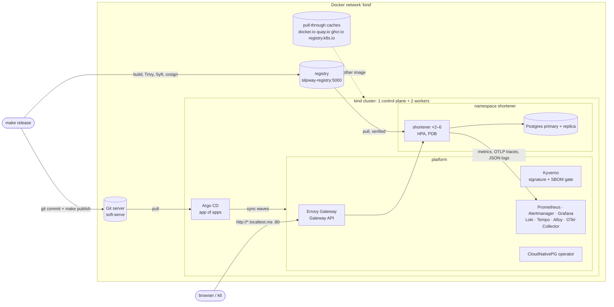

# Architecture

Slipway is a small but complete platform: a cluster, a release pipeline, GitOps, an entry point,
policies, observability with SLOs, a highly available database, and one real workload to run on
it. This page explains how the pieces connect. The decisions behind them are in [adr/](adr/).

## The picture

## Layers

| Layer | What | Where |
|---|---|---|
| Infrastructure | kind cluster, registry, caches, Git server, Argo CD + root app | `infra/terraform/envs/local` (Terraform) |
| GitOps | one Argo CD Application per component, sync waves 0 → 2 | `platform/apps` (Helm chart) |
| Platform | charts pinned by version, values per component and per environment | `platform/values` |
| Entry point | `Gateway` "platform", routes for Grafana, Argo CD, Prometheus; Envoy per environment | `platform/gateway/{base,local,aws}` |
| Policy | signed images with an SBOM; restricted baseline for app namespaces | `platform/policies/{base,local,aws}` |
| Observability | SLO recording and alerting rules, the service dashboard | `platform/observability` |
| Workload | shortener Deployment, HPA, PDB, Service, route, monitor, database | `platform/workloads/shortener` |

## How a change reaches the cluster
1. **Platform change** (a chart version, a values file, a policy): commit, `make publish`. The
   laptop pushes `HEAD` to the Git server; Argo CD sees it (hard refresh on publish, polling every
   60 s otherwise) and syncs. Self-heal reverts manual edits in the cluster.
2. **Release** (`make release`): build the image with a new tag, scan it (Trivy fails on fixable
   HIGH/CRITICAL), push, generate an SPDX SBOM (Syft), sign it and attest the SBOM (cosign), then
   bump the tag in the local overlay, commit and publish. Argo CD rolls it out with
   `maxUnavailable: 0, maxSurge: 1`.
3. **Admission:** in application namespaces (label `slipway.dev/policy=restricted`), for every pod
   using an image from `slipway-registry:5000`, Kyverno checks the signature and the SBOM
   attestation against the release key and pins the tag to the verified digest. Those pods must
   also be non-root, pinned and have resources. Kyverno's webhooks only see those namespaces, so a
   Kyverno outage cannot block the platform itself.
4. **Rollback:** `git revert` the release commit, `make publish`.

## Request path
`http://sho.localtest.me` → `127.0.0.1:80` → kind control-plane port mapping → NodePort 30080 →
the Envoy on that node (a DaemonSet, `externalTrafficPolicy: Local`) → `HTTPRoute shortener` → Service `shortener` → pod :8080 → Postgres through
`shortener-db-rw`. Probes and `/metrics` are on a separate admin port (9090) that no route exposes.

## Telemetry path
- **Metrics:** `ServiceMonitor shortener` (15 s). Histogram buckets include 0.3 s (the latency
  SLO) and carry exemplars with the `trace_id`. CloudNativePG exposes its own `PodMonitor`.
- **Traces:** OTLP/HTTP → `otel-collector.monitoring:4318` → Tempo. Parent-based 20 % sampling.
- **Logs:** JSON on stdout → Alloy (DaemonSet) → Loki. Errors include `trace_id`.
- **Alerts:** PrometheusRule `shortener-slo` → Alertmanager. See [slo.md](slo.md).

## Resilience built in
| Failure | What handles it |
|---|---|
| A shortener pod dies | ReplicaSet replaces it; ≥ 2 replicas (HPA min) on different nodes; PDB for drains |
| A worker node dies | pods tolerate `not-ready`/`unreachable` for 30 s (default 300 s), then move; an Envoy runs on every node, and the one taking outside traffic is on the control plane |
| The Postgres primary dies | CloudNativePG promotes the replica and repoints `shortener-db-rw` |
| Shutdown / rollout | the pod goes unready, waits 5 s for endpoints to update, then drains in-flight requests (20 s) |
| A bad release | burn-rate page, runbook, `git revert` |
| Postgres not ready at start | the app retries with backoff for about a minute |

Chaos day tests each of these under load: [chaos-day.md](chaos-day.md).

## Sizing (8 GB Docker VM)
Every component has small requests and limits. Off on purpose: Argo CD's Dex, notifications and
ApplicationSet controller; Kyverno's cleanup controller; Loki's caches, gateway, canary and rules
sidecar; scraping of etcd, scheduler, controller-manager and kube-proxy (kind binds them to
localhost). Prometheus and Alertmanager run on the control-plane node so a worker loss never
takes the evidence with it.

## Local and AWS
The same `platform/` tree is meant for both. The root Application sets `env` (`local` or `aws`)
and `repoURL` (the in-laptop Git server or GitHub). The differences live in
`platform/values/<env>/` (node placement), `platform/gateway/<env>` (Envoy as a NodePort DaemonSet
vs. two replicas behind an NLB), `platform/policies/<env>` (local release key vs. keyless signatures
from CI) and the workload's `overlays/<env>` (registry, image tag, hostnames). The AWS environment
(`infra/terraform/envs/aws`) is written and checked offline but has never been applied: there is
no AWS account behind this project.
